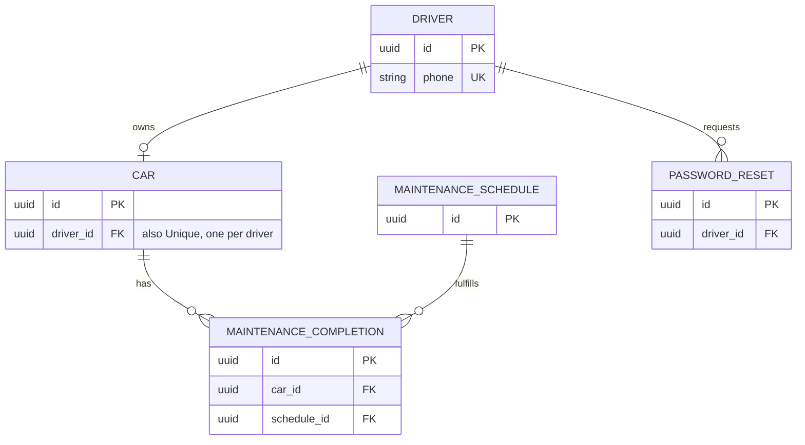

# Vehicle Maintenance Tracker: Data & API Design

> **When:** Week 3 (Sections 0–2), Week 4 (Sections 3–4) · **Owner:** Architecture Lead (in a team of 4, the Data & API owner) · **Done when:** every item in the SVC Self-Check at the end is true.
>
> **Version:** 1.0
>
> **Approved on:** ___ **by:** Architecture Lead ___ · Product Owner ___ · Delivery Lead ___
>
> **Filled-in Example:** `docs/examples/data-api-design-example.md`

This document turns the Spec's nouns into data and its user actions into endpoints. If the built app and this document disagree, this document wins until it's deliberately changed. Unresolved questions go in the Spec's Open Questions.

---

## 0. Database & Storage

**Database:** PostgreSQL via Supabase. Confirmed here; Delorean is matching ADR-00 in `plan.md` to this choice. Relational fits this data well: every entity below is a clean table with foreign keys, and nothing needs document-style nesting.

**Build option:** Simulated backend for the course build (JSON seed data and browser storage, per ADR-00). Designing for the real database above so the simulation can be swapped out later without changing entity names, fields, or endpoints.

**Proposed simulated behaviors** (matches ADR-05 and ADR-00 in `plan.md`, pending Michal's confirmation): sign-up, sign-in, and password reset use fabricated identities and designated demo credentials, clearly labeled as simulated. The reset code is shown on screen instead of actually texted. Reminder emails are written to a visible in-app notification log instead of actually sent. No real SMS or email provider is called during the course build.

**We store:** A driver's account (phone number, password), their one car (make, model, year, mileage), the maintenance schedule for supported vehicles, every completed maintenance task with its date and mileage, and short-lived password reset codes.

**We do NOT store:** Plaintext passwords (password_hash only). Reset codes outlive their 10-minute window only long enough to expire; an expired or used code is never valid again regardless of what's in the table.

**Sensitive fields:** phone (login identifier), password_hash, email (optional, reminders only), reset code. All four are scoped to a single driver and never exposed to another driver, per Constitution 2.

*This template assumes a relational database (tables, rows, keys).*

---

## 1. Entities

**Key:** `PK` = identifies each row · `FK → Entity` = points to another entity's PK · `Unique` = no two rows can share this value. For every FK, say what happens when the parent is deleted: **block** it, or **delete** the children too.

**Entity: Driver**

| Field | Type | Key | Required? | Req ID |
|-------|------|-----|-----------|--------|
| id | uuid | PK | Yes | |
| phone | string | Unique | Yes | R24, R25, R26, R28 |
| password_hash | string | | Yes | R24, R27 |
| email | string | | No | R20, R21, R22 |
| reminders_enabled | boolean | | Yes | R20 |
| created_at | timestamp | | Yes | |

**Entity: Car**

| Field | Type | Key | Required? | Req ID |
|-------|------|-----|-----------|--------|
| id | uuid | PK | Yes | |
| driver_id | uuid | FK → Driver, Unique | Yes | R1, R13, Scope (one car per driver) |
| make | string | | Yes | R1, R2 |
| model | string | | Yes | R1, R2 |
| year | integer | | Yes | R1, R2 |
| mileage | integer | | Yes | R1, R2, R16 |
| initial_mileage | integer | | Yes | R10, R17 (Q1) |

`mileage` is the car's current reading, updated by R16 whenever the driver logs a new number. `initial_mileage` is captured once at setup (R1) and never changes again.

**Q1, missing-service-history rule:** a task's due point is `initial_mileage + interval_miles` until the driver actually logs a completion for it, at which point it becomes `completed_mileage + interval_miles` from that completion. Updating the car's current `mileage` (R16) never moves a due point; it only changes whether a task shows as overdue (current `mileage` ≥ due point, R17). This closes the bug Delorean found in the prototype, where raising a car's mileage was silently pushing an unlogged task's due point forward and hiding work that was actually due. The assumption built into `initial_mileage`: a car is treated as freshly serviced on every task as of setup, since setup only collects make, model, year, and mileage (R2 caps it at four fields, so there's no room to ask what was last done and when). This can show a task as "not due yet" when it's really overdue for a car that wasn't freshly serviced, and the team should decide if that tradeoff needs a caveat in the UI copy.

Delete rule: if a Driver is deleted, their Car is deleted too. No requirement covers account deletion yet; this is an assumption to flag for the team, chosen because an orphaned car with no owner conflicts with Constitution 2.

**Entity: MaintenanceSchedule**

Reference data, not driver input; seeded for a limited, curated list of vehicles. Resolves Open Question Q1: schedules come from hand-built standard intervals sourced from published manufacturer-recommended intervals for a limited set of supported make/model/year combinations, not a live outside data source. A car whose make/model/year has no matching row falls back to R8's "we don't have a schedule for this car yet" message.

| Field | Type | Key | Required? | Req ID |
|-------|------|-----|-----------|--------|
| id | uuid | PK | Yes | |
| make | string | | Yes | R8 (Q1) |
| model | string | | Yes | R8 (Q1) |
| year | integer | | Yes | R8 (Q1) |
| task_name | string | | Yes | R6 |
| explanation | text | | Yes | R6, R7, Constitution 1 |
| interval_miles | integer | | Yes | R4, R10, R17 (Q1) |

**Entity: MaintenanceCompletion**

| Field | Type | Key | Required? | Req ID |
|-------|------|-----|-----------|--------|
| id | uuid | PK | Yes | |
| car_id | uuid | FK → Car | Yes | R9, R13 |
| schedule_id | uuid | FK → MaintenanceSchedule | Yes | R9, R10 |
| completed_date | date | | Yes | R9, R11 |
| completed_mileage | integer | | Yes | R9, R12 |

Delete rules: if the Car is deleted, its completions are deleted too (same account-deletion assumption as above). If a MaintenanceSchedule row is deleted, that's blocked as long as any completion still references it, so completed history never loses its task name and explanation.

**Failure behavior (closes ADR-06's open item):** a rejected completion, whether from a future date (R11) or a mileage lower than the car's last recorded mileage (R12), writes nothing. No MaintenanceCompletion row is created, and Car.mileage and Car.initial_mileage are both left unchanged. A save only succeeds and only then does ADR-06's single operation run: write the completion, advance Car.mileage if the completion's mileage is higher, and the next due value recalculates automatically since it's computed from the new completed_mileage, not stored separately.

**Entity: PasswordReset**

| Field | Type | Key | Required? | Req ID |
|-------|------|-----|-----------|--------|
| id | uuid | PK | Yes | |
| driver_id | uuid | FK → Driver | Yes | R29 |
| code | string | | Yes | R29, R31 |
| expires_at | timestamp | | Yes | R31 |
| used | boolean | | Yes | R30, R31 |

Delete rule: if the Driver is deleted, their reset records are deleted too.

---

## 2. Entity Relationship Diagram (ERD)

*`||--o{` means "one to zero-or-many". `||--o|` means "one to zero-or-one".*

---

## 3. Normalization Check

- [ ] **1NF** — every field holds one value (no lists or comma-separated values in a field).
- [ ] **2NF** — every field depends on the whole primary key.
- [ ] **3NF** — no field depends on another non-key field (e.g. don't store `event_name` on a photo — store `event_id`).

**Intentional exceptions:** *(Any rule you broke on purpose, and why — or "None".)*

---

## 4. API Endpoints

*One row per user action. The path names a thing; the method says what to do with it.*

| Req ID | Method | Path | Request | Success response | Errors | Who can call it |
|--------|--------|------|---------|------------------|--------|-----------------|
| | | | | | | Anyone / Member / Admin |

*Common status codes: `200` OK · `201` Created · `400` bad input · `401` not logged in · `403` not allowed · `404` not found · `409` conflict (e.g. duplicate).*

---

## SVC Self-Check

- [ ] **Simple** — entities are plain nouns from the Spec; paths are nouns, not verbs (`/photos`, not `/getPhotos`).
- [ ] **Valuable** — every field and endpoint has a requirement ID; anything without one has been cut; sensitive fields are named and protected.
- [ ] **Complete** — the database matches ADR-00; every P1 requirement that stores or reads data has its entity and endpoint; every FK has a delete rule; the ERD renders and shows cardinality; the normalization check is done, with any exception explained; every endpoint says who can call it; the team has approved it.
